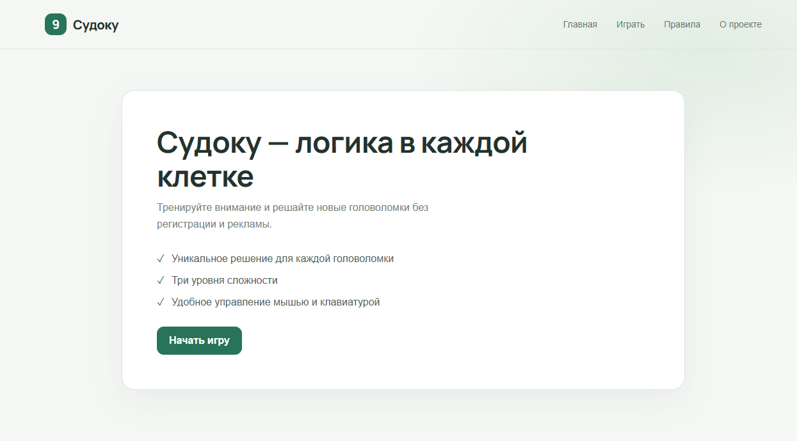
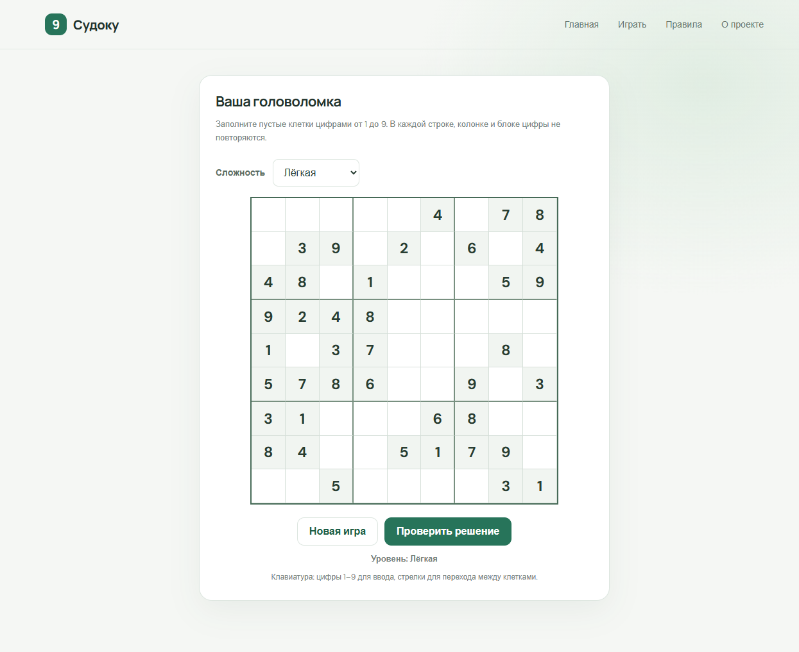
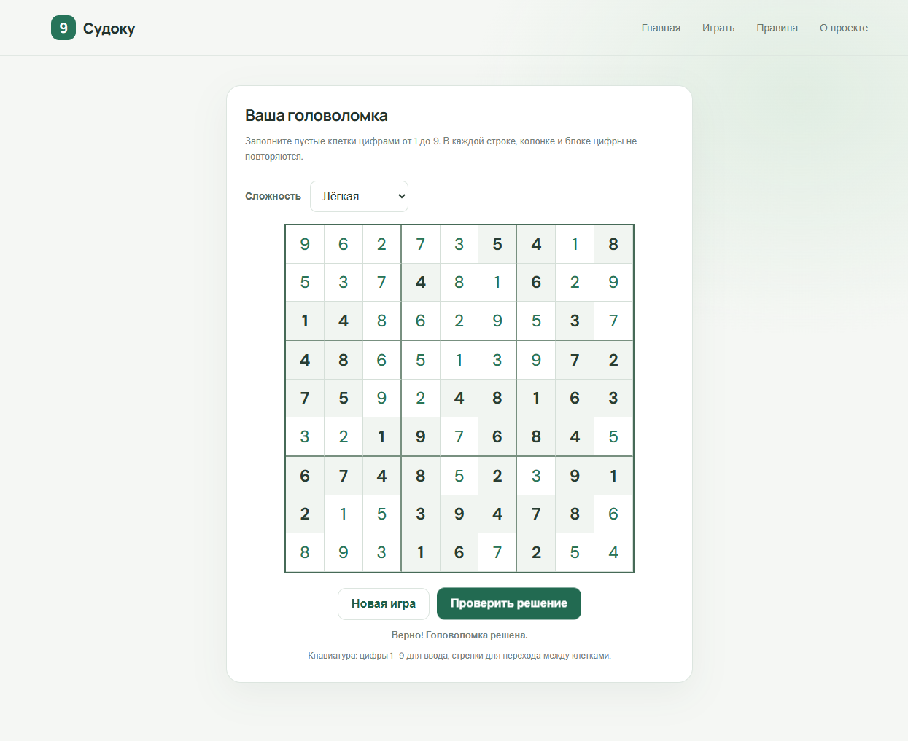

# Судоку

Учебный проект — настольная браузерная игра «Судоку» с клиентской генерацией головоломок и проверкой решений. Проект сделан на TypeScript и разделён на основное приложение и библиотеку общих UI-компонентов.

## Возможности

- Новые головоломки трёх уровней сложности (лёгкая, средняя, сложная).
- Генерация решения с проверкой единственности головоломки.
- Ввод цифр и перемещение по клеткам стрелками клавиатуры.
- Подсветка конфликтующих значений и проверка завершённого решения.
- Страницы правил и сведений о проекте.

## MVP и демонстрация основного сценария

Основной сценарий MVP — решить сгенерированную головоломку и получить результат проверки:

1. Запустите приложение и откройте страницу «Играть».
2. Выберите уровень сложности. Приложение создаст новую головоломку с единственным решением.
3. Заполняйте пустые клетки цифрами от 1 до 9 мышью и клавиатурой; стрелки перемещают фокус.
4. Повтор цифры в строке, столбце или блоке подсвечивается сразу.
5. Нажмите «Проверить решение»: незаполненная сетка попросит заполнить пустые клетки, правильное решение покажет сообщение об успехе.

Данные партии хранятся только в текущем состоянии страницы и не отправляются на сервер.

## Запуск

Требуется Node.js 20 или новее и npm.

```bash
npm ci
npm run build
npm run dev
```

Откройте адрес, указанный Vite (по умолчанию `http://127.0.0.1:5173`). Для остановки сервера нажмите Ctrl+C.

## Проверки

Из корня репозитория:

```bash
npm run lint
npm test
npm run test:coverage
npm run build
```

У каждого workspace-проекта также есть команды `dev`, `build`, `lint`, `lint:fix`, `test` и `test:coverage`. Для общих UI-компонентов порог покрытия задан на уровне 90% по statements, branches, functions и lines.

## Скриншоты демонстрации

### Стартовая страница



### Игровое поле до решения



### Успешная проверка решения



## Структура

- [`apps/web`](apps/web) — приложение, страницы, маршруты и алгоритмы игры.
- [`packages/ui`](packages/ui) — общие компоненты `Button` и `Card` с unit-тестами.
- [`architecture.md`](architecture.md) — описание архитектуры и зависимостей.
- [`mvp.md`](mvp.md) — сценарий использования и границы первой версии.
