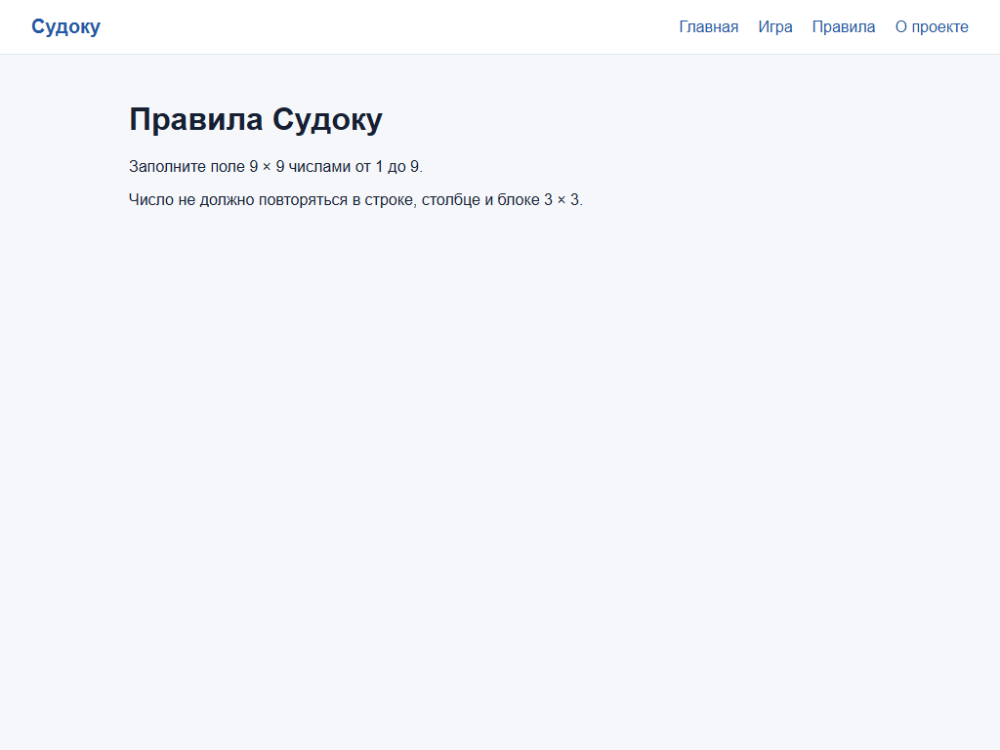
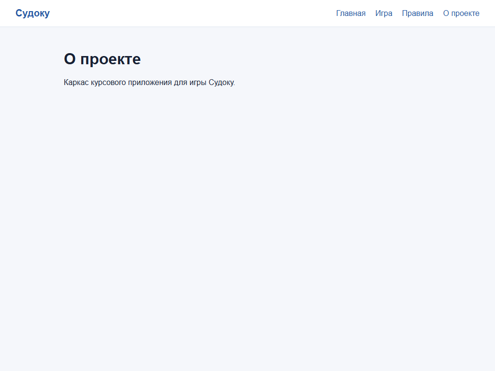

# Sudoku Course Project

Учебное каркасное приложение для игры Судоку.
На первом этапе реализованы страницы, маршрутизация и библиотека общих компонентов.

## Стек

- TypeScript
- Vite
- Vitest
- ESLint

## Структура

- `apps/web` — основное веб-приложение
- `packages/ui` — библиотека общих компонентов
- `architecture.md` — архитектура проекта
- `mvp.md` — границы MVP

## Запуск

```bash
npm install
npm run dev
```

Приложение будет доступно по адресу `http://127.0.0.1:5173`.

## Проверки

```bash
npm run build
npm run lint
npm run test
npm run test:coverage
```

## Скриншоты

### Главная страница


### Страница игры


### Правила



### О проекте

